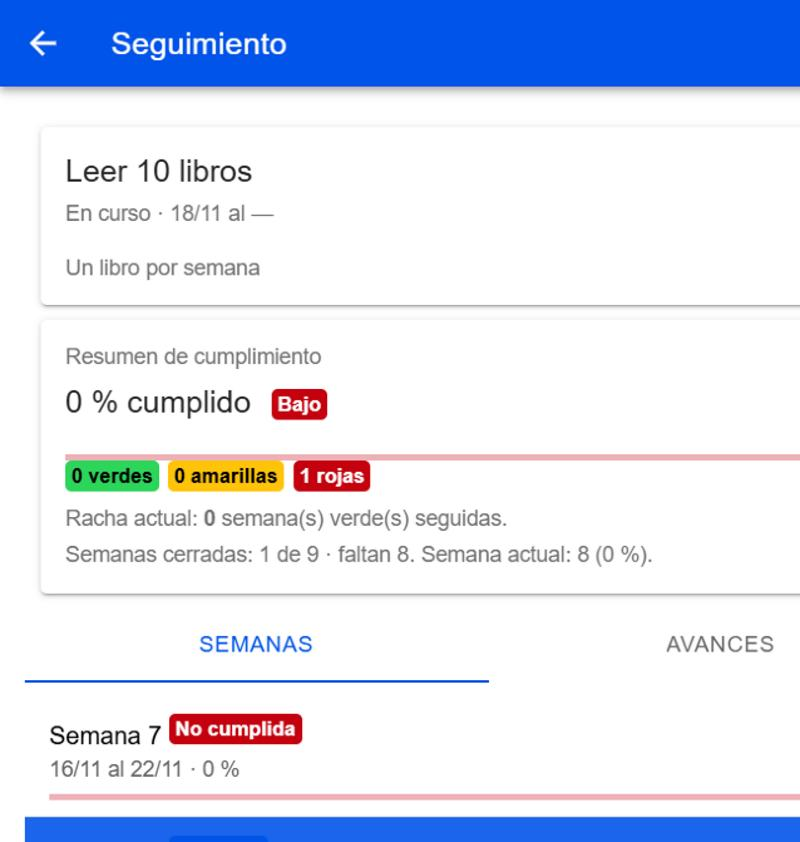
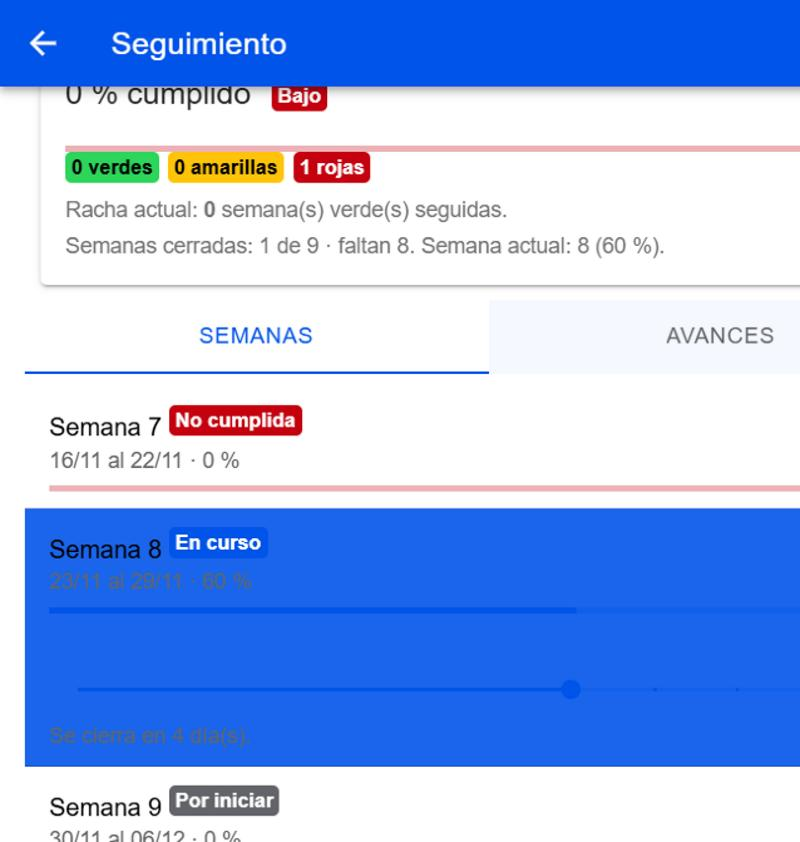
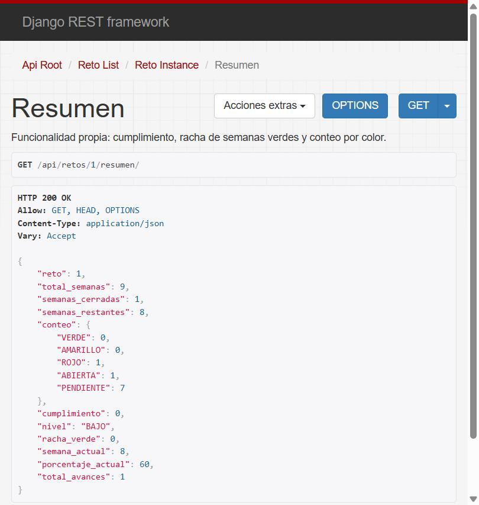
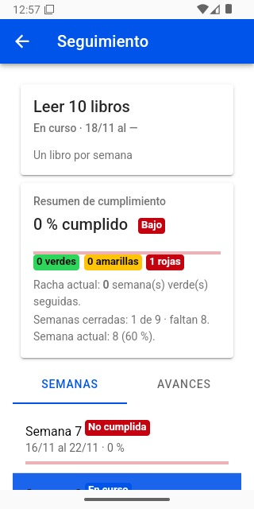
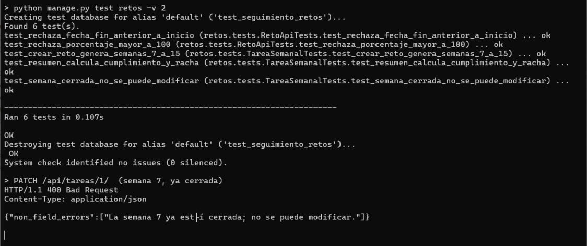

# Seguimiento de Retos

Aplicación para registrar retos personales y hacer su seguimiento semanal (semanas 7 a 15) con un semáforo de colores. Tiene tres partes:

- **Backend:** Django + Django REST Framework + MySQL 8.4 (`backend/`).
- **Frontend web:** Ionic + Angular (`frontend/`).
- **Android:** Capacitor (`frontend/android/`), que consume la API en `10.0.2.2:8000`.

## Cómo ejecutarla

```powershell
# Backend
cd backend
.\.venv\Scripts\Activate.ps1
python manage.py migrate
python manage.py test retos
python manage.py runserver 0.0.0.0:8000

# Web (otra terminal) -> http://localhost:8100
cd frontend
npx.cmd ng serve --port 8100

# Android
npm.cmd run build
npx.cmd cap sync android
npx.cmd cap open android
```

Las credenciales se leen de `backend/.env`, que no se sube al repositorio.

## Funcionalidad propia: resumen de cumplimiento del reto

### Propósito

El semáforo de la guía muestra el color de cada semana por separado, pero no responde a la pregunta "¿cómo voy en este reto en general?". Esta función agrega, en el detalle de cada reto, una tarjeta de **resumen de cumplimiento** con:

- El **porcentaje de cumplimiento**: el promedio de las semanas ya cerradas.
- Un **nivel**: *Bueno* (80 % o más), *Regular* (50 a 79 %) o *Bajo* (menos de 50 %).
- El **conteo de semanas** verdes, amarillas y rojas.
- La **racha actual**: cuántas semanas verdes seguidas lleva el estudiante hasta la última semana cerrada.
- Las semanas cerradas, las que faltan y el porcentaje de la semana en curso.

El cálculo lo hace el backend con las mismas reglas del semáforo del frontend (verde con 100 %, rojo con menos de 10 %, amarillo en otro caso), así que la web y Android muestran siempre el mismo resultado. La tarjeta se actualiza sola cada vez que se guarda el porcentaje de una semana.

### Endpoint

`GET /api/retos/{id}/resumen/`

```json
{
  "reto": 1,
  "total_semanas": 9,
  "semanas_cerradas": 1,
  "semanas_restantes": 8,
  "conteo": { "VERDE": 0, "AMARILLO": 0, "ROJO": 1, "ABIERTA": 1, "PENDIENTE": 7 },
  "cumplimiento": 0,
  "nivel": "BAJO",
  "racha_verde": 0,
  "semana_actual": 8,
  "porcentaje_actual": 30,
  "total_avances": 1
}
```

### Archivos modificados

| Archivo | Cambio |
|---|---|
| `backend/retos/resumen.py` | **Nuevo.** Calcula el color de cada semana, el cumplimiento, el nivel y la racha. |
| `backend/retos/views.py` | Acción `resumen` en `RetoViewSet` (`GET /api/retos/{id}/resumen/`). |
| `backend/retos/tests.py` | Prueba `test_resumen_calcula_cumplimiento_y_racha`. |
| `frontend/src/app/core/modelos.ts` | Interfaz `ResumenCumplimiento`. |
| `frontend/src/app/core/retos-api.service.ts` | Método `resumenReto(id)`. |
| `frontend/src/app/paginas/reto-detalle.page.ts` | Tarjeta "Resumen de cumplimiento", que se recarga cuando cambian las semanas. |
| `frontend/proxy.conf.json`, `frontend/angular.json`, `frontend/src/app/core/api.config.ts` | Proxy de desarrollo para que `ng serve` llame a la API por `/api`. |

### Capturas

Resumen en la web:



El resumen se actualiza al guardar el porcentaje de la semana:



Endpoint en la API:



Resumen en Android:



Pruebas del backend (6 en OK):


